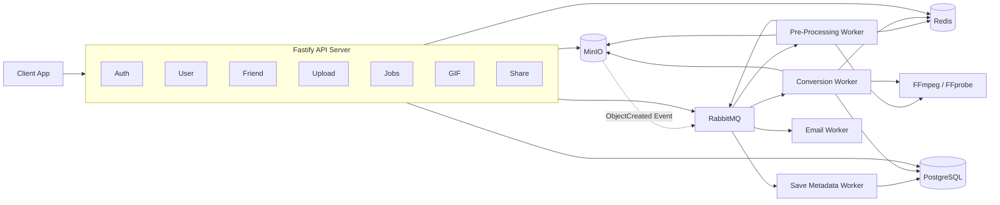
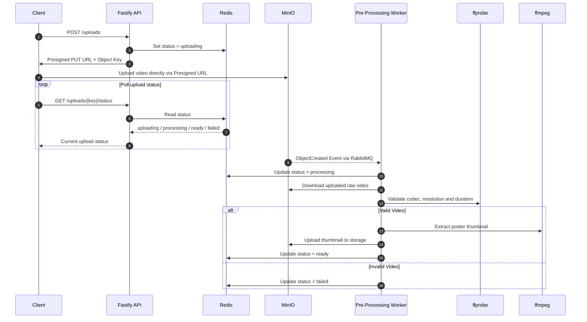
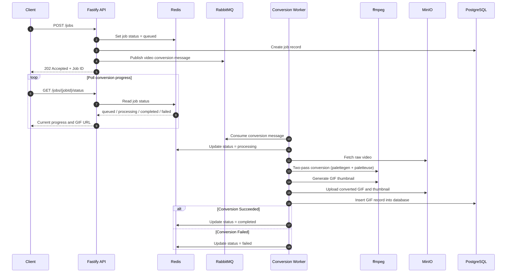

# FFGif (Node.js)

> **Asynchronous Video-to-GIF Conversion & Sharing Platform built with Fastify, TypeScript, PostgreSQL, Prisma, MinIO, Redis, RabbitMQ, and FFmpeg.**

<p align="center">
  
  
  
  
  
  
  
  
  
</p>

---

## Overview

**FFgif** is an event-driven video conversion and asset sharing backend. Designed with Clean Architecture and production-grade backend patterns, it allows users to upload high-definition videos, trim exact time windows, customize framerates and scaling, and convert them asynchronously into high-quality GIFs.

This repository is a strict 1:1 architectural port of the Go implementation into **Fastify + TypeScript** (Node LTS, Strict Mode).

---

## Project Demo

<p align="center">
  
</p>

---

## Features

### Authentication & Security
- **JWT-Based Authentication**: Access token generation (`@fastify/jwt`) with standard claims (`sub`, `iss`, `email`, `fullname`, `role`), bearer authorization, and cryptographic signature validation.
- **Email Verification Flow**: Account activation workflow with time-limited cryptographic SHA-256 tokens delivered via SMTP / Mailtrap.
- **Password Recovery**: Secure forgot-password and password-reset flow with single-use cryptographic tokens.
- **Instant Token Blocklisting**: Redis-backed token revocation on logout to immediately invalidate active sessions using remaining JWT TTL.
- **Enterprise Password Security**: Bcrypt password hashing combined with a server-side secret pepper (`password + pepper`) and configurable work cost.
- **Optimistic Concurrency Control**: `If-Match` / ETag header validation on profile and GIF updates.

### Zero-Byte Direct Cloud Storage & Ingestion
- **Direct MinIO S3 Presigned Uploads**: Clients upload raw video binaries directly to MinIO object storage—the Node.js backend never proxies heavy video payloads.
- **Event-Driven Ingestion**: MinIO `s3:ObjectCreated` bucket notifications publish directly to a RabbitMQ fanout exchange, completely decoupling file upload from background processing.
- **Live Upload Status & Streaming**: Real-time polling for upload readiness and instant video streaming via time-limited presigned URLs.
- **Automated Lifecycle Eviction**: MinIO lifecycle configuration automatically purges unprocessed temporary uploads after configured TTL days.

### Video-to-GIF Engine
- **Asynchronous Worker Pool**: Dedicated RabbitMQ worker queues for video pre-validation, GIF conversion, metadata persistence, and email dispatching.
- **Frame-Accurate Video Trimming**: Precision start and duration cropping powered by native FFmpeg execution.
- **Optimized Palette Generation**: Two-pass FFmpeg conversion (`palettegen` + `paletteuse`) ensuring silky-smooth color gradients without banding or artifacts.
- **Full Customization**: Granular control over output framerate (up to 30 FPS), custom dimensions / resolution scaling, and loop count.
- **Automatic Thumbnail Extraction**: Extracts poster frames on ingestion and conversion for fast frontend previews.

### GIF Management
- **Metadata & Analytics**: Track GIF dimensions, duration, visibility, and download metrics.
- **One-Click Persistence**: Seamlessly save and promote temporary preview GIFs into permanent storage.
- **Public & Private Visibility**: Toggle individual GIFs between private user view and public galleries.

### Sharing
- **Targeted User-to-User Sharing**: Share GIFs with specific registered users with configurable expiration timestamps.
- **Public Share Links (`/s/:token`)**: Generate shareable, tokenized public links for users outside the platform with download permissions.
- **Instant Revocation**: Owners can revoke shared access at any time without affecting the underlying asset.

### Friends
- **Friend Request Pipeline**: Send, accept, reject, and list incoming friend requests.
- **Friend List Management**: Manage friendships and view accepted connections.
- **User Discovery**: Look up user profiles and explore public GIF galleries by user ID.

---

## Architecture

### High-Level System Architecture



<details>
<summary><strong>Video Upload Workflow</strong></summary>

### Video Upload Workflow



</details>

<details>
<summary><strong>Video Conversion Workflow</strong></summary>

### Video Conversion Workflow



</details>

---

## Tech Stack

| Component | Technology |
|---|---|
| **Runtime & Language** | Node.js v22+ (LTS) / TypeScript 5.9 (Strict Mode) |
| **HTTP Framework** | Fastify v5 (`@fastify/jwt`, `@fastify/cors`, `@fastify/static`) |
| **Database** | PostgreSQL 16 + `pg_cron` |
| **ORM & Migrations** | Prisma 6 (`prisma migrate dev` / `@prisma/client`) |
| **Cache & Blocklist** | Redis 7 + `ioredis` |
| **Object Storage** | MinIO S3 (`minio` Node.js SDK) |
| **Message Queue** | RabbitMQ 3 (Management) + `amqplib` |
| **Video Processing** | FFmpeg & FFprobe (via async subprocess `child_process.spawn`) |
| **Auth & Security** | JWT (`@fastify/jwt`) + `bcrypt` (with pepper) |
| **Email Delivery** | Nodemailer (SMTP + Mailtrap) |
| **Validation** | Zod (Runtime validation with static compile-time type inference) |
| **Testing** | Vitest 5 (Parallel unit tests & Fastify `inject` HTTP simulation) |
| **Containerization** | Docker & Docker Compose |

---

## Project Structure

```
.
├── docker-compose.yml              # Local multi-service orchestrator
├── Dockerfile.api                  # Fastify API multi-stage container
├── Dockerfile.worker               # FFmpeg worker multi-stage container
├── Dockerfile.postgres             # PostgreSQL 16 container with pg_cron
├── docs/                           # Architecture guides and cheatsheets
│   └── CHEATSHEET.md               # Standalone Go vs Fastify/TypeScript guide
├── prisma/                         # Prisma declarative schema and migrations
│   └── schema.prisma               # Single source of truth database models
├── public/                         # Exported static Next.js frontend assets
├── src/                            # Clean Architecture application source
│   ├── application/                # Business logic use cases (1 service per operation)
│   │   ├── auth/                   # Signup, Login, Logout, Verify, Resend, Forgot, Reset
│   │   ├── friend/                 # Send, Accept, Reject, Remove, List Friends, List Pending
│   │   ├── media/                  # Upload, Stream, Convert, Status, Recents, Thumbnail, Save
│   │   ├── share/                  # Create Share, Share by Token, Get Shares, Download
│   │   └── user/                   # Profile, Quota, Change Password, Delete Account
│   ├── config/                     # Environment configuration loader with Zod validation
│   ├── domain/                     # Pure domain entities, repository interfaces & domain errors
│   │   ├── auth/                   # User, credential & verifier models
│   │   ├── friend/                 # Friendship models & repository interfaces
│   │   ├── media/                  # GIF, upload & storage models
│   │   ├── share/                  # GIF share models & repository interfaces
│   │   └── user/                   # Profile & quota models
│   ├── infrastructure/             # Concrete adapters & external drivers
│   │   ├── ffmpeg/                 # FFmpeg/FFprobe subprocess runner & palettegen
│   │   ├── mailer/                 # SMTP / Mailtrap client via Nodemailer
│   │   ├── minio/                  # MinIO S3 object storage & bucket setup
│   │   ├── postgres/               # PostgreSQL Prisma repositories
│   │   ├── rabbitmq/               # RabbitMQ publisher, consumer, DLX & retry topology
│   │   └── redis/                  # Redis cache & token blocklist adapter
│   ├── transport/                  # HTTP delivery layer
│   │   └── http/                   # Fastify server, encapsulated routes & schemas
│   │       ├── plugins/            # Auth guard preHandler hooks & decorators
│   │       ├── routes/             # Auth, Friend, Media, Share, User, Static routes
│   │       ├── schemas/            # Zod validation schemas
│   │       └── server.ts           # Fastify server factory
│   ├── workers/                    # RabbitMQ background consumers
│   │   ├── converter_worker.ts     # Video-to-GIF conversion consumer
│   │   ├── email_worker.ts         # SMTP email dispatcher consumer
│   │   ├── raw_upload_worker.ts    # MinIO SQS upload notification consumer
│   │   ├── save_metadata_worker.ts # GIF metadata persistence consumer
│   │   └── index.ts                # Background worker supervisor entrypoint
│   └── index.ts                    # HTTP API server entrypoint
├── tests/                          # Test suites
│   ├── integration/                # In-memory HTTP flow tests
│   └── unit/                       # Isolated service and domain unit tests
├── package.json                    # Scripts and dependencies
└── tsconfig.json                   # Strict TypeScript compiler options
```

---

## Setup

### Prerequisites

- Docker & Docker Compose
- Node.js v22+ (for local development)

### Environment Variables

Copy `.env.example` to `.env` and configure your credentials:

```bash
cp .env.example .env
```

| Variable | Default / Example | Required | Description |
|---|---|---|---|
| `VERSION` | `1.0.0` | Yes | Application release version |
| `SERVICE_NAME` | `ffgif` | Yes | Service identifier name |
| `ADDR` | `0.0.0.0` | Yes | Server bind address |
| `PORT` | `8080` | Yes | HTTP server listening port |
| `JWT_SECRET` | `secret-key` | Yes | Secret key used for signing & validating JWT tokens |
| `HASH_PEPPER` | `pepper-string` | Yes | Secret pepper added before password hashing |
| `BCRYPT_COST` | `12` | Yes | Work factor / cost for bcrypt hashing |
| `PG_ADDRESS` | `postgres` | Yes | PostgreSQL host address |
| `PG_PORT` | `5432` | Yes | PostgreSQL port |
| `PG_USER` | `ffgif` | Yes | PostgreSQL application username |
| `PG_PASSWORD` | `secret` | Yes | PostgreSQL application password |
| `PG_NAME` | `ffgif` | Yes | PostgreSQL database name |
| `PG_SSLMODE` | `disable` | Yes | PostgreSQL SSL connection mode |
| `PG_SUPERUSER` | `postgres` | Yes | Admin username for schema initialization and `pg_cron` |
| `PG_SUPERDB` | `postgres` | Yes | Superuser default database name |
| `REDIS_ADDR` | `redis:6379` | Yes | Redis host and port for token blocklist & cache |
| `RMQ_ADDR` | `rabbitmq:5672` | Yes | RabbitMQ broker address |
| `RMQ_USER` | `guest` | Yes | RabbitMQ username |
| `RMQ_PASS` | `guest` | Yes | RabbitMQ password |
| `MINIO_ADDR` | `minio:9000` | Yes | Internal MinIO S3 API address |
| `MINIO_ROOT_USER` | `minioadmin` | Yes | MinIO root administrator username |
| `MINIO_ROOT_PASSWORD` | `minioadmin` | Yes | MinIO root administrator password |
| `MINIO_TEMP_BUCKET` | `uploads` | Yes | S3 bucket for incoming video uploads and transient GIFs |
| `MINIO_PERSIST_BUCKET`| `storage` | Yes | S3 bucket for permanently saved user GIFs and thumbnails |
| `MINIO_TEMP_BUCKET_TTL_DAYS` | `1` | No | Automated lifecycle eviction period (days) for temp bucket |
| `MINIO_API_CORS_ALLOW_ORIGIN`| `http://localhost:8080` | Yes | Allowed origins for direct browser S3 uploads |
| `MINIO_NOTIFY_EXCHANGE` | `notify.upload.exchange` | Yes | RabbitMQ fanout exchange for MinIO `s3:ObjectCreated` events |
| `MINIO_PUBLIC_ENDPOINT` | `127.0.0.1:9000` | Yes | Publicly reachable MinIO host for presigned URLs |
| `EMAIL` | `verify@ffgif.com` | Yes | Sender email address for system notifications |
| `SMTP_HOST` | `smtp.gmail.com` | Yes | SMTP server hostname |
| `SMTP_PORT` | `587` | Yes | SMTP server port |
| `SMTP_USER` | `ffgif@gmail.com` | Yes | SMTP authentication username |
| `SMTP_PASS` | `app-password` | Yes | SMTP authentication password |
| `MAILTRAP_USERNAME` | `mailtrap-user` | No | Mailtrap sandbox username (alternative to SMTP) |
| `MAILTRAP_PASSWORD` | `mailtrap-pass` | No | Mailtrap sandbox password |

### Build and Run with Docker Compose

```bash
docker compose up -d --build
```

### Docker Services

```
services:
  postgres:   → PostgreSQL with pg_cron
  redis:      → Redis for token blocklist & caching
  rabbitmq:   → RabbitMQ message broker with Management UI (port 15672)
  minio:      → MinIO S3 object storage with Console (port 9001)
  api:        → Fastify REST API server & static frontend serving (port 8080)
  worker:     → Asynchronous background workers (FFmpeg conversion, emails, metadata)
```

### Demo Login

```
Email: anonymous@ffgif.local
Pass: anonymous@ffgif
```

---

## Running Tests

### Unit Tests (No Docker Required)

Runs domain, application, and utility tests using Vitest:

```bash
# Run all unit tests
npm test

# Run tests in interactive watch mode
npm run test:watch
```

### Type Checking & Linting

```bash
# TypeScript strict mode verification
npx tsc --noEmit

# ESLint code quality checks
npm run lint
```

---

## API Overview

Base URL: `http://localhost:8080`

| Endpoint | Method | Role | Description |
|---|---|---|---|
| `/auth/signup` | `POST` | Public | Registers new user and queues email verification token |
| `/auth/login` | `POST` | Public | Authenticates credentials and returns JWT access token |
| `/auth/logout` | `POST` | Authenticated | Logs out user and blocklists JWT token in Redis |
| `/auth/verify` | `GET` | Public | Verifies user email address via token query parameter (`?token=`) |
| `/auth/verify/resend` | `POST` | Public | Resends account verification email |
| `/auth/forgot-password` | `POST` | Public | Triggers password reset email with secure token |
| `/auth/reset` | `GET` | Public | Validates password reset token (`?token=`) |
| `/auth/reset` | `POST` | Public | Sets new account password with verified reset token |
| `/users/me/profile` | `GET` | Authenticated | Retrieves current authenticated user profile |
| `/users/me/profile` | `PATCH` | Authenticated | Updates user profile details (`If-Match` / ETag support) |
| `/users/:userId/profile` | `GET` | Authenticated | Retrieves public profile information of another user |
| `/users/me/quota` | `GET` | Authenticated | Returns current conversion quotas and tier limits |
| `/users/me/change-password`| `PATCH` | Authenticated | Updates password using old and new credentials |
| `/users/me` | `DELETE` | Authenticated | Permanently deletes user account and all stored media |
| `/friends` | `GET` | Authenticated | Lists all accepted friends for the user |
| `/friends/requests` | `POST` | Authenticated | Sends a new friend request to target user |
| `/friends/requests` | `GET` | Authenticated | Lists pending incoming friend requests |
| `/friends/requests/:id` | `PATCH` | Authenticated | Accepts an incoming friend request |
| `/friends/requests/:id` | `DELETE` | Authenticated | Rejects or cancels a friend request |
| `/friends/:id` | `DELETE` | Authenticated | Removes a user from friend list |
| `/uploads` | `POST` | Authenticated | Generates presigned MinIO PUT URL for direct video upload |
| `/uploads/:key/status` | `GET` | Authenticated | Polls upload validation, duration, and thumbnail status |
| `/uploads/:key/stream` | `GET` | Authenticated | Returns presigned stream URL for raw video preview |
| `/uploads/last` | `GET` | Authenticated | Retrieves metadata of the user's most recent video upload |
| `/jobs` | `POST` | Authenticated | Enqueues async FFmpeg video-to-GIF conversion job |
| `/jobs/:jobId/status` | `GET` | Authenticated | Polls conversion job status (`pending`, `processing`, `completed`) |
| `/gifs/me` | `GET` | Authenticated | Lists all permanent GIFs owned by authenticated user |
| `/gifs/me/recents` | `GET` | Authenticated | Lists recently converted temporary GIFs |
| `/gifs/me/recents/:key/save` | `POST` | Authenticated | Persists a temporary recent GIF to permanent storage |
| `/gifs/user/:userId` | `GET` | Authenticated | Lists public GIFs belonging to a specific user |
| `/gifs/me/:key` | `GET` | Authenticated | Retrieves metadata and properties of a specific GIF |
| `/gifs/me/:key` | `PATCH` | Authenticated | Updates GIF metadata or visibility (`public`/`private`) |
| `/gifs/me/:key` | `DELETE` | Authenticated | Deletes a GIF and purges associated MinIO files |
| `/gifs/me/:key/download` | `GET` | Authenticated | Generates a time-limited presigned download URL |
| `/gifs/me/:key/thumbnail` | `GET` | Authenticated | Generates a presigned URL for GIF thumbnail preview |
| `/gifs/me/:key/shares` | `POST` | Authenticated | Shares a GIF with a specific registered user with expiry |
| `/gifs/me/shares` | `GET` | Authenticated | Lists all GIFs shared by or shared with the authenticated user |
| `/gifs/me/:key/shares/:shareWithId` | `DELETE` | Authenticated | Revokes shared access for a specific user |
| `/s` | `POST` | Authenticated | Creates a public token-based share link |
| `/s/:token` | `GET` | Public | Views public shared GIF metadata via token |
| `/s/:token/download` | `GET` | Public | Downloads public shared GIF via token |
| `/health` | `GET` | Public | Liveness / readiness health check endpoint |
| `/` | `GET` | Public | Serves exported web application and static assets |

---

## Known Limitations

- **Presigned Upload Ceilings**: MinIO presigned PUT URLs currently lack content-length-range enforcement; large uploads rely on client compliance before processing.
- **Polling-Based Status**: Clients poll `GET /jobs/{jobId}/status` and `GET /uploads/{key}/status` rather than receiving real-time push events.
- **Pagination**: List endpoints (`/gifs/me`, `/gifs/me/shares`) currently return unpaginated datasets.
- **Ephemeral GIF Retention**: Unpersisted (`persist = false`) GIFs do not yet have an automated MinIO lifecycle eviction rule after 24 hours.
- **Local Development TLS**: Local Docker environment runs over HTTP; production deployments require an SSL/TLS reverse proxy (e.g. Caddy or Nginx).

---

## Planned / Future Work

- **Real-Time Updates**: Replace polling with WebSockets or Server-Sent Events (SSE) for conversion job progress.
- **Export Formats**: Support WebP, APNG, and reverse GIF-to-MP4 conversions.
- **Rich GIF Editing**: Add text overlays, captions, speed adjustments, and filters via FFmpeg.
- **Smart Discovery**: AI/vector-based semantic search and GIF recommendations.
- **Webhooks**: Outbound webhooks on job completion for third-party integrations.
- **Observability**: Prometheus metrics export and OpenTelemetry tracing for conversion latency, queue depth, and storage usage.

---

## 📖 Architecture & Language Cheatsheet

For an in-depth standalone tutorial comparing Go constructs with TypeScript and Fastify patterns (Goroutines vs. Event Loop, Plugins, Prisma Transactions, RabbitMQ DLX topology, etc.), see:

👉 [**docs/CHEATSHEET.md**](docs/CHEATSHEET.md)
